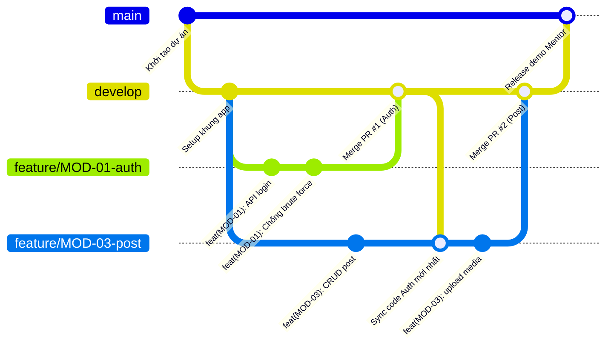

# QUY ƯỚC QUẢN LÝ MÃ NGUỒN VÀ QUY TRÌNH LÀM VIỆC NHÓM VỚI GIT
## (GIT TEAM WORKFLOW & CONVENTIONS)
**Dự án:** Hệ thống Quản lý Truyền thông Đa kênh (Multi-Channel Communication Management System)  
**Đơn vị thực hiện:** Nhóm 7 RikkeiLab 2  
**Phiên bản:** 1.1 - Cập nhật hướng dẫn làm việc nhóm toàn diện  

---

## 📖 MỤC LỤC
1. [Mô hình nhánh tổng thể (Branching Model)](#1-mô-hình-nhánh-tổng-thể-branching-model)
2. [Quy ước đặt tên nhánh (Branch Naming Conventions)](#2-quy-ước-đặt-tên-nhánh-branch-naming-conventions)
3. [Quy ước thông điệp Commit (Conventional Commits)](#3-quy-ước-thông-điệp-commit-conventional-commits)
4. [Quy trình 6 bước làm việc hàng ngày của từng thành viên](#4-quy-trình-6-bước-làm-việc-hàng-ngày-của-từng-thành-viên)
5. [Quy chuẩn Pull Request (PR) & Code Review](#5-quy-chuẩn-pull-request-pr--code-review)
6. [Cẩm nang xử lý xung đột (Merge Conflict Resolution)](#6-cẩm-nang-xử-lý-xung-đột-merge-conflict-resolution)
7. [Bảng tóm tắt câu lệnh Git "bỏ túi" cho cả nhóm](#7-bảng-tóm-tắt-câu-lệnh-git-bỏ-túi-cho-cả-nhóm)
8. [Quy tắc bảo mật mã nguồn](#8-quy-tắc-bảo-mật-mã-nguồn)

---

## 1. MÔ HÌNH NHÁNH TỔNG THỂ (BRANCHING MODEL)

Dự án áp dụng mô hình **Git Flow tinh gọn (Simplified Git Flow)** để đảm bảo sự ổn định của sản phẩm và khả năng cộng tác nhóm mượt mà:



### 1.1. Các nhánh cố định (Permanent Branches)
* **`main`**:
  * Nhánh lưu trữ mã nguồn môi trường Production (chuẩn bị demo bảo vệ đồ án trước Mentor).
  * **Quy tắc nghiêm ngặt**: Tuyệt đối **KHÔNG commit trực tiếp** lên nhánh `main`. Mọi thay đổi bắt buộc phải thông qua Pull Request (PR) được kiểm duyệt từ nhánh `develop` hoặc `hotfix`.
* **`develop`**:
  * Nhánh tích hợp chính của nhóm.
  * Toàn bộ các tính năng sau khi hoàn thành và vượt qua kiểm thử cục bộ sẽ được tạo PR gộp vào nhánh này.

---

## 2. QUY ƯỚC ĐẶT TÊN NHÁNH (BRANCH NAMING CONVENTIONS)

| Loại nhánh | Mục đích | Nguồn tạo nhánh | Đích merge vào | Định dạng tên nhánh |
| :--- | :--- | :--- | :--- | :--- |
| **`feature`** | Phát triển tính năng mới theo từng Module | `develop` | `develop` | `feature/<MOD-XX>-<ten-ngan-gon>` |
| **`bugfix`** | Sửa lỗi phát hiện trong quá trình sprint | `develop` | `develop` | `bugfix/<issue-id>-<ten-loi>` |
| **`hotfix`** | Sửa lỗi nghiêm trọng phát sinh trên `main` | `main` | `main` & `develop` | `hotfix/<ten-loi-khan-cap>` |
| **`docs`** | Cập nhật tài liệu, README, sơ đồ | `develop` | `develop` | `docs/<noi-dung-tai-lieu>` |

#### Ví dụ chuẩn:
* `feature/MOD-01-auth-login`
* `feature/MOD-02-user-management`
* `feature/MOD-03-post-crud`
* `feature/MOD-04-approval-workflow`
* `feature/MOD-05-schedule-calendar`
* `feature/MOD-06-tracking-publish`
* `feature/MOD-07-analytics-export`
* `bugfix/issue-12-jwt-expired-handling`

---

## 3. QUY ƯỚC THÔNG ĐIỆP COMMIT (CONVENTIONAL COMMITS)

Áp dụng chuẩn **Conventional Commits v1.0.0**:

### 3.1. Cấu trúc cú pháp
```
<type>(<scope>): <mô tả ngắn gọn bằng tiếng Anh hoặc tiếng Việt>
```

### 3.2. Danh sách các `type` được phép:
* **`feat`**: Tính năng mới (ví dụ: `feat(MOD-01): implement brute force login protection`)
* **`fix`**: Sửa lỗi mã nguồn (ví dụ: `fix(MOD-03): handle invalid video mime types`)
* **`docs`**: Thay đổi tài liệu, markdown (ví dụ: `docs(readme): add docker setup instructions`)
* **`style`**: Định dạng code, dấu cách, thụt dòng (ví dụ: `style(core): format code with black`)
* **`refactor`**: Tái cấu trúc code không thêm tính năng hay sửa lỗi (ví dụ: `refactor(services): optimize approval transaction flow`)
* **`perf`**: Cải tiến hiệu năng truy vấn, xử lý (ví dụ: `perf(analytics): add database composite indexes`)
* **`test`**: Bổ sung unit test / integration test (ví dụ: `test(auth): add test cases for failed login attempts`)
* **`chore`**: Công việc phụ trợ: cập nhật dependencies, docker (ví dụ: `chore(deps): update fastapi and pydantic`)

---

## 4. QUY TRÌNH 6 BƯỚC LÀM VIỆC HÀNG NGÀY CỦA TỪNG THÀNH VIÊN

Giả sử bạn được phân công làm **MOD-01 (Đăng nhập)**, bạn sẽ thực hiện đúng 6 bước chuẩn sau:

### 🔹 Bước 1: Kéo code mới nhất từ `develop` về máy
Mỗi buổi sáng bắt đầu làm việc, luôn cập nhật nhánh `develop` trên máy mình:
```bash
git checkout develop
git pull origin develop
```

### 🔹 Bước 2: Tạo nhánh riêng cho tính năng của mình
Tạo nhánh mới từ `develop` theo quy ước:
```bash
git checkout -b feature/MOD-01-auth-login
```

### 🔹 Bước 3: Viết code và Commit thường xuyên
Chia nhỏ công việc thành các commit có nghĩa, không dồn cả tuần mới commit:
```bash
# Sau khi xong chức năng mã hóa mật khẩu
git add .
git commit -m "feat(MOD-01): implement bcrypt password hashing"

# Sau khi xong chức năng tạo JWT token
git add .
git commit -m "feat(MOD-01): implement jwt token generation"
```

### 🔹 Bước 4: Đồng bộ code từ `develop` trước khi nộp (Tránh conflict)
Trước khi gửi code lên, kéo code mới nhất mà các bạn khác vừa merge vào `develop`:
```bash
git checkout develop
git pull origin develop
git checkout feature/MOD-01-auth-login
git merge develop
```
* Chạy thử server `uvicorn app.main:app --reload`. Nếu chạy tốt, chuyển sang Bước 5.

### 🔹 Bước 5: Đẩy nhánh lên GitHub và Tạo Pull Request (PR)
```bash
git push -u origin feature/MOD-01-auth-login
```
* Vào giao diện GitHub của repo $\rightarrow$ Nhấn nút **"Compare & pull request"**.
* Chọn:
  * **base (đích đến)**: `develop`
  * **compare (nhánh của bạn)**: `feature/MOD-01-auth-login`
* Điền tiêu đề và mô tả theo template có sẵn: `[MOD-01] Xây dựng chức năng Đăng nhập và Khóa tài khoản`.
* Chọn **Reviewers**: Gán tên bạn cùng nhóm hoặc Tech Lead.

### 🔹 Bước 6: Review code và Merge
* Reviewer vào kiểm tra phần thay đổi (Files changed) $\rightarrow$ Nhấn **Approve**.
* Nhóm trưởng hoặc người tạo PR bấm **"Squash and merge"** để gộp commit gọn gàng trên `develop`.
* Xóa nhánh `feature/MOD-01-auth-login` trên GitHub sau khi merge xong.

---

## 5. QUY CHUẨN PULL REQUEST (PR) & CODE REVIEW

### 5.1. Tiêu chuẩn của một Pull Request
* **Tiêu đề PR**: `[MOD-XX] <Mô tả ngắn gọn>`  
  *Ví dụ:* `[MOD-03] Xây dựng API Upload Media và kiểm tra giới hạn 10MB/50MB`
* **Nội dung PR**: Điền theo mẫu tự động tại `.github/pull_request_template.md`.
* **Điều kiện bắt buộc để Merge**:
  * Tối thiểu **1 Reviewer duyệt (`Approved`)**.
  * Chạy pass toàn bộ kiểm tra cú pháp và test local.
  * Phương thức merge: **Squash and merge** để giữ lịch sử git thẳng và sạch.

---

## 6. CẨM NANG XỬ LÝ XUNG ĐỘT (MERGE CONFLICT RESOLUTION)

### 6.1. Tại sao cấu trúc Backend giúp nhóm tránh 95% xung đột?
Nhờ thiết kế **Module hóa phân tầng**:
* Bạn làm **Auth** chỉ sửa trong: `routers/auth.py`, `services/auth_service.py`, `schemas/auth.py`.
* Bạn làm **Post** chỉ sửa trong: `routers/posts.py`, `services/post_service.py`, `schemas/post.py`.
* Bạn làm **Approval** chỉ sửa trong: `routers/approvals.py`, `services/approval_service.py`.
$\rightarrow$ Vì không đụng chạm vào cùng dòng code trong cùng 1 file, Git sẽ **tự động gộp mã nguồn (Auto-merge)** mà không hề phát sinh lỗi!

### 6.2. Các bước xử lý khi chẳng may bị Conflict
Nếu 2 bạn lỡ sửa chung 1 file (ví dụ cùng chỉnh sửa `app/config.py`):
1. Git sẽ thông báo: `CONFLICT (content): Merge conflict in app/config.py`.
2. Mở file bị xung đột trong VS Code, Git sẽ hiển thị rõ ràng:
   ```python
   <<<<<<< HEAD (Code hiện tại của bạn)
   SECRET_KEY = "my_key_1"
   =======
   SECRET_KEY = "my_key_2"
   >>>>>>> develop (Code của bạn kia)
   ```
3. VS Code có sẵn các nút bấm trực quan:
   * **Accept Current Change**: Giữ code của bạn.
   * **Accept Incoming Change**: Lấy code của bạn kia.
   * **Accept Both Changes**: Giữ lại cả hai.
4. Trao đổi nhanh với bạn cùng nhóm để chọn phương án đúng $\rightarrow$ Lưu file $\rightarrow$ Chạy lệnh kết thúc xung đột:
   ```bash
   git add app/config.py
   git commit -m "fix: resolve merge conflict in config"
   git push origin <tên-nhánh-của-bạn>
   ```

---

## 7. BẢNG TÓM TẮT CÂU LỆNH GIT "BỎ TÚI" CHO CẢ NHÓM

| Thao tác nghiệp vụ | Câu lệnh Git thực hiện |
| :--- | :--- |
| **Kéo code mới nhất từ develop** | `git checkout develop && git pull origin develop` |
| **Tạo và chuyển sang nhánh mới** | `git checkout -b feature/<MOD-XX>-<tên-nhánh>` |
| **Kiểm tra các file đã chỉnh sửa** | `git status` |
| **Lưu thay đổi tạm vào Git** | `git add .` |
| **Tạo một commit hoàn chỉnh** | `git commit -m "feat(scope): mô tả công việc"` |
| **Đẩy nhánh lên GitHub lần đầu** | `git push -u origin <tên-nhánh>` |
| **Đẩy các commit tiếp theo** | `git push` |
| **Chuyển đổi giữa các nhánh** | `git checkout <tên-nhánh>` |
| **Hủy bỏ thay đổi chưa commit** | `git restore .` |
| **Xóa nhánh local sau khi đã merge** | `git branch -d <tên-nhánh>` |

---

## 8. QUY TẮC BẢO MẬT MÃ NGUỒN

1. **Tuyệt đối không commit tệp `.env` chứa mật khẩu thực tế hoặc Secret Key lên GitHub.**
2. Chỉ commit file `.env.example` với các giá trị mẫu/placeholder.
3. Nếu lỡ commit thông tin nhạy cảm (API Key, Mật khẩu Database), phải lập tức liên hệ nhóm để thu hồi key và xóa lịch sử git commit kịp thời.
